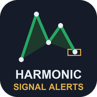
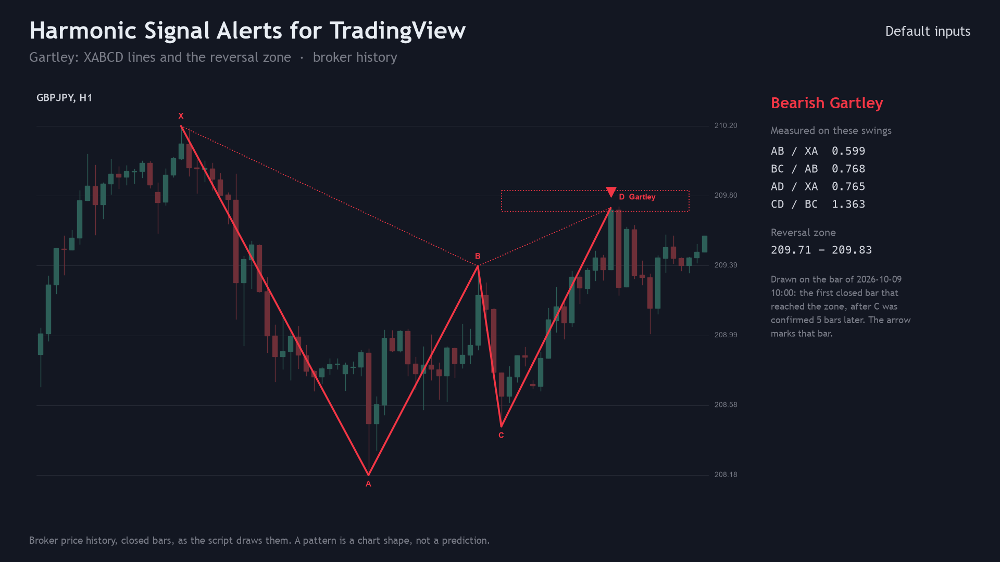
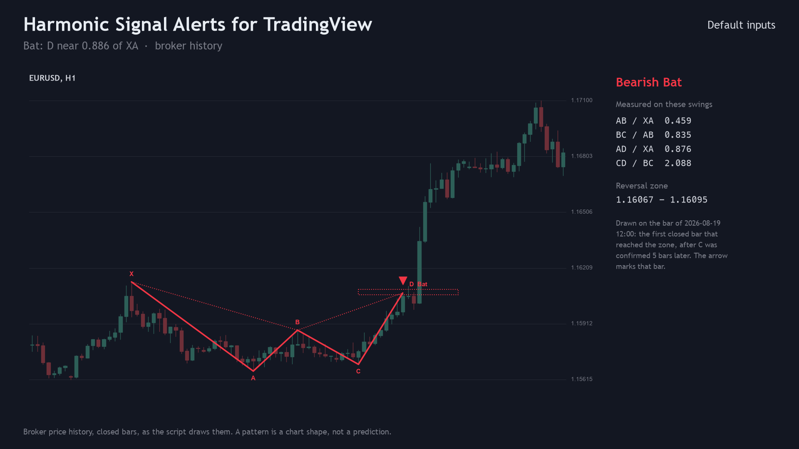
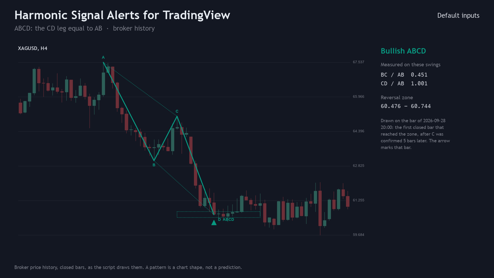
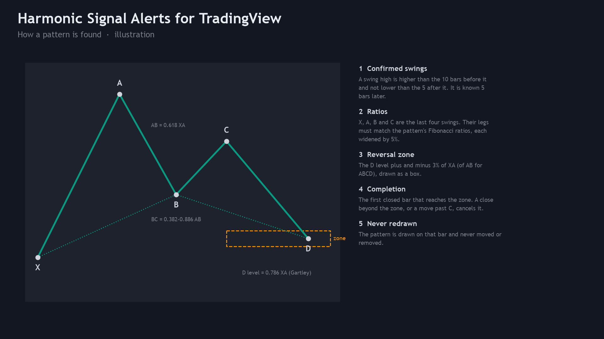
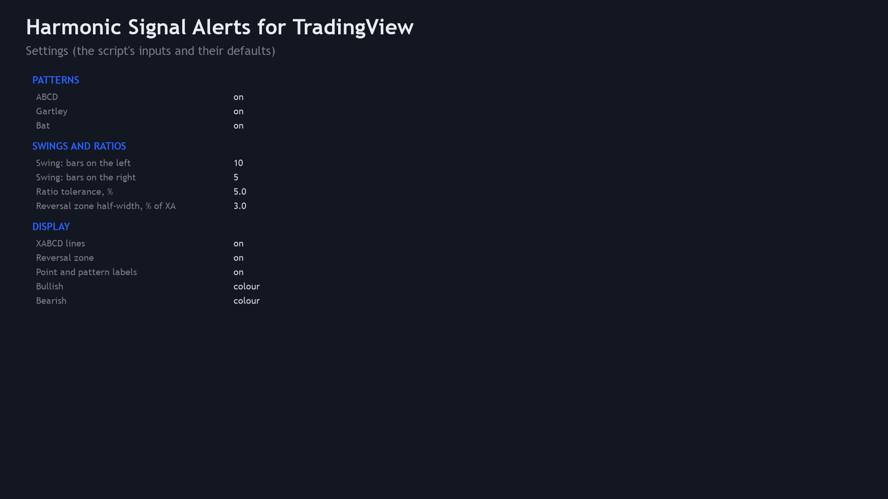
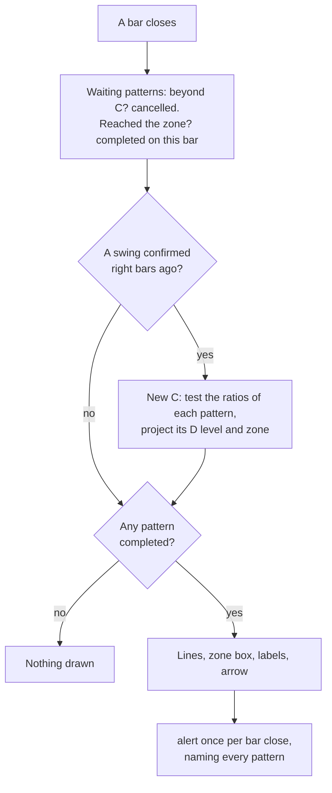
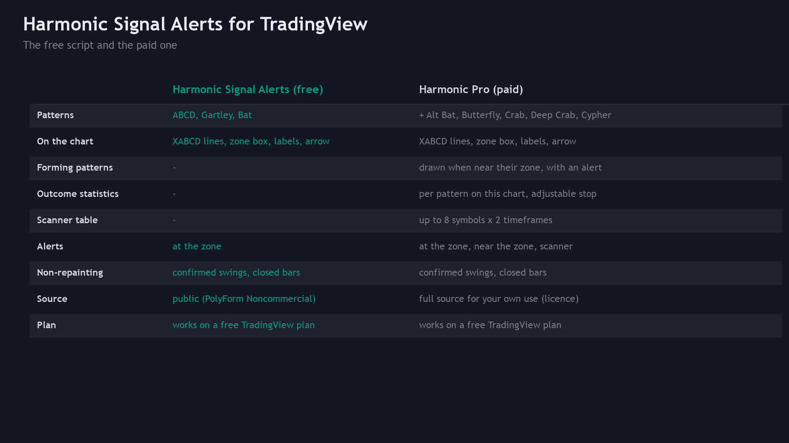

<p align="center"></p>

# Harmonic Signal Alerts for TradingView (Pine Script v6)

A free TradingView indicator that finds **ABCD, Gartley and Bat** harmonic patterns from confirmed swing points, draws
each one (XABCD lines, reversal zone, point labels) and marks the **closed bar** where price reached the reversal zone.
It can send one alert per bar that names every pattern that completed. Pine Script v6 source, a Python reference of the
rules, and the test that checks the script against the reference bar by bar.

**Website:** [allanninal.dev](https://www.allanninal.dev) · MetaTrader editions: [allanninal.dev/mql5 (indicators)](https://www.allanninal.dev/mql5/#indicators)
· **Contact:** message me on [LinkedIn](https://www.linkedin.com/in/allanninal/).



> It is an indicator, not a strategy. It draws shapes and places no trades. Nothing here is a profit claim
> (see [Honest limits](#honest-limits)).

## Contents

1. [Install in the Pine Editor](#install-in-the-pine-editor)
2. [What it is and who it is for](#what-it-is-and-who-it-is-for)
3. [How it works](#how-it-works)
4. [Non-repainting](#non-repainting)
5. [Inputs and alerts](#inputs-and-alerts)
6. [Tests](#tests)
7. [Honest limits](#honest-limits)
8. [Free vs Pro](#free-vs-pro)
9. [Licence](#licence)

## Install in the Pine Editor

Works on every TradingView plan, including the free Basic plan. The script is not published on TradingView; you add it
from this source.

1. Open [`pine/HarmonicSignalAlerts.pine`](pine/HarmonicSignalAlerts.pine) and copy the whole file (the "Raw" button,
   then select all).
2. On a TradingView chart, open the **Pine Editor** tab at the bottom, create a new indicator and replace its text with
   the copied code.
3. Click **Save**, then **Add to chart**. The indicator appears as "Harmonic Alerts" and is kept in your own scripts.

To get alerts: right-click the chart, **Add alert**, choose **Harmonic Signal Alerts** as the condition and then either
**Any alert() function call** (one message per closed bar that names every pattern) or **Bullish pattern** /
**Bearish pattern**. Free plans limit how many alerts can be active at once.

## What it is and who it is for

**What:** three textbook harmonic patterns found by fixed ratio rules on confirmed swings. A bullish pattern ends at a
low (D below C), a bearish one at a high. When a closed bar reaches the pattern's reversal zone, the script draws:

- the legs X-A, A-B, B-C, C-D as solid lines, and X-B and B-D dotted (ABCD: A-C and B-D dotted);
- the reversal zone as a dotted box from C to 10 bars past the completion bar;
- labels X, A, B, C at the swings and `D  Gartley` (every pattern that completed there) at D;
- an arrow on the completion bar.

**For:** traders who use harmonic patterns and want them found with a definition they can read and check.

**Not for:** anyone who expects a pattern to predict direction. A harmonic pattern is a set of ratios between swings.

| | |
|---|---|
|  |  |
|  |  |

Image notes: the charts are drawn from the Python reference on broker price history, which the script matches bar for
bar (see [Tests](#tests)); the how-it-works and settings sheets are illustrations, not TradingView captures.

## How it works

### 1. Confirmed swings

A **swing high** at bar `p` has a high above each of the `left` bars before it (default 10) and not below any of the
`right` bars after it (default 5). It is therefore known `right` bars later, on the bar `p + right`. A swing low
mirrors it. Swings alternate high and low:

- a swing of the same type as the last one replaces it only when it is more extreme (a higher high, a lower low);
- a swing on the wrong side of the last one (a low at or above the last high, or the reverse) is ignored;
- a bar that is both a swing high and a swing low adds only the type that alternates.

### 2. Ratios

When a new swing (C) arrives, the last four swings are X, A, B, C (ABCD uses A, B, C). Each switched-on pattern checks
its ratios; every value and range end is widened by the tolerance (default 5%, so 0.618 accepts 0.587-0.649).

| Pattern | AB / XA | BC / AB | D level | CD / BC at the D level |
|---|---|---|---|---|
| ABCD | - | 0.382-0.886 | CD = AB (D = C - AB) | - |
| Gartley | 0.618 | 0.382-0.886 | 0.786 of XA from A | 1.13-1.618 |
| Bat | 0.382-0.50 | 0.382-0.886 | 0.886 of XA from A | 1.618-2.618 |

These are the commonly published Fibonacci definitions; the D level must lie beyond C in the pattern's direction.

### 3. Reversal zone and completion

- **Zone:** the D level plus and minus `zone` x XA (ABCD: x AB), default 3%. The edge on C's side is the near edge.
- **Completion:** on each closed bar after C, the lowest low since C (bullish; the highest high for bearish) is
  compared with the near edge. The first bar where it reaches the zone completes the pattern, and **that bar** gets the
  arrow, never an earlier one. D is the extreme since C.
- **Cancelled:** a bar beyond C ends the pattern (C has moved), and if any close since C went beyond the far edge before
  completion, the pattern is void (it overshot).



### How often patterns appear

On broker history with the default inputs, the same rules (as measured on the MetaTrader edition, 2023-2026) find about
2-3 patterns per symbol per month on H1, about 10 on M15 and fewer than 1 on H4. The rules and numbering are shared
with the MetaTrader editions ([allanninal/harmonic-signal-alerts](https://github.com/allanninal/harmonic-signal-alerts)).

## Non-repainting

- A swing is used only after the `right` bars that confirm it have **closed**; no swing is assumed in advance.
- Completion, drawings and alerts are gated by `barstate.isconfirmed`: nothing is decided on the forming bar.
- A completed pattern is drawn on the bar it became known and is never moved or removed. No `request.security`, no
  future bars.
- Alerts use `alert.freq_once_per_bar_close`.

The arrow therefore comes `right` bars or more after the swings it uses, by design. This was tested, not only reasoned
about: see [Tests](#tests).

## Inputs and alerts

| Input | Default | Meaning |
|---|---|---|
| ABCD, Gartley, Bat | all on | Switch a pattern on or off |
| Swing: bars on the left | 10 | A swing high is higher than each of this many bars before it |
| Swing: bars on the right | 5 | ... and not below any of this many bars after it: the confirmation delay |
| Ratio tolerance, % | 5.0 | Every ratio and range end is widened by this share of itself |
| Reversal zone half-width, % of XA | 3.0 | Zone = D level +/- this share of XA (ABCD: of AB) |
| XABCD lines, Reversal zone, Point and pattern labels | on | What is drawn |
| Bullish, Bearish | `#089981`, `#F23645` | Colours (TradingView's own candle colours by default) |

Every input has a tooltip in the settings dialog. Two hidden plots, "Bullish patterns (bit mask)" and "Bearish patterns
(bit mask)", show in the Data Window: bit 0 ABCD, 1 Gartley, 2 Bat.

| Alert condition | Message |
|---|---|
| Any alert() function call | `GBPJPY 60: bearish Gartley reached the reversal zone` (every pattern of the bar, bullish and bearish) |
| Bullish pattern | `Bullish harmonic pattern reached its zone on {{ticker}} {{interval}}` |
| Bearish pattern | `Bearish harmonic pattern reached its zone on {{ticker}} {{interval}}` |

**Drawing limits:** TradingView keeps at most 500 lines, 500 labels and 500 boxes per script (the script asks for the
maximum). A pattern uses up to 6 lines, 1 box and 5 labels, so on a long chart the oldest drawings drop off (about the
latest 80 patterns keep their lines); the arrows and the Data Window masks stay on every bar.

## Tests

Run on this exact code:

| Check | Result |
|---|---|
| Compile (TradingView's Pine v6 compiler) | 0 errors, 0 warnings |
| Parity: script vs [`tests/reference.py`](tests/reference.py), every bar | 0 mismatches: 271 patterns (defaults) and 575 (swings 5/3, tolerance 3%, zone 5%), 12 series, 60,000 bars |
| Repaint: re-run on the series cut at 3 points, closed bars compared with the full run | 0 of 878,328 closed-bar values changed |

Parity compares, on every bar: the bullish and bearish pattern masks, the bars of X, A, B, C and D (sum and sum of
squares), D's price and the zone edges. A test-only block is appended to a temporary copy of the script to plot these
values; the published script is not changed.

Data: the latest 5,000 closed bars of EURUSD, GBPJPY, XAUUSD and BTCUSD on M15, H1 and H4 (12 series, broker history),
with the default inputs and with a tighter set (swings 5/3, tolerance 3%, zone 5%). The script runs locally in
[PineTS](https://github.com/LuxAlgo/PineTS), a Pine v6 runtime (AGPL-3.0, installed for testing only). To repeat it on
your own bars:

```bash
cd tests/runner && npm install && cd ../..          # PineTS, installed for testing only
python3 -m venv .venv && . .venv/bin/activate && pip install -r requirements.txt
python3 tests/check_pine.py <folder of SYMBOL_TF.csv files: time (unix ms), open, high, low, close>
```

It prints the mismatches per configuration, the repaint count and `ALL PASS` or `FAIL`. The price files used for the
numbers above are not in this repository (they are broker price data).

## Honest limits

- **A pattern is not a strategy.** No stop-loss, position sizing or exit rules are provided or implied, and the ratios
  were not optimised or back-tested for profit. No edge is claimed anywhere.
- **The definitions are one reading.** Harmonic ratios have several published variants, and other tools find swings
  differently, so patterns will differ from other scripts.
- **Late by design.** A swing is confirmed `right` bars after it, and a pattern only counts once a closed bar reaches
  the zone. Lower `right` gives earlier, noisier swings.
- **Rare on higher timeframes:** fewer than one pattern per symbol per month on H4 with the defaults.
- **Drawing limits:** see [Inputs and alerts](#inputs-and-alerts).
- **Scope of the tests.** PineTS is a separate runtime from TradingView's; the script was compile-checked with
  TradingView's compiler and matched in PineTS on the 12 series above. Other symbols, timeframes and data feeds are not
  covered by these numbers.

## Free vs Pro

| | Free: Harmonic Signal Alerts | Paid: Harmonic Pro |
|---|---|---|
| Patterns | ABCD, Gartley, Bat | + Alt Bat, Butterfly, Crab, Deep Crab, Cypher (8) |
| XABCD lines, zone box, labels, arrow, alerts | yes | yes |
| Forming patterns near their zone, drawn and alerted | no | yes |
| Outcome statistics table | no | yes |
| Table of several symbols and timeframes | no | yes |
| Confirmed swings, closed bars only | yes | yes |
| Source | this repository (PolyForm Noncommercial) | delivered to the buyer, personal-use licence |
| Price | free | paid, one-time |

No need to buy the paid script to use this one: the free indicator is complete on its own. Harmonic Pro is described at
[allanninal.dev](https://www.allanninal.dev) (page coming soon).



## Licence

Copyright 2026 Allan Niñal (<https://www.allanninal.dev>). Licensed under the
[PolyForm Noncommercial License 1.0.0](LICENSES/PolyForm-Noncommercial-1.0.0.md): public source, free for personal and
other noncommercial use, not for commercial use. Text: [`LICENSE`](LICENSE). Please do not republish this script on
TradingView or elsewhere as your own. The pattern ratios are commonly published definitions; the code is original.
Trading involves risk; the software is provided as is.

---

**Website:** [allanninal.dev](https://www.allanninal.dev) · [MetaTrader editions](https://www.allanninal.dev/mql5/#indicators)
· Questions: message me on [LinkedIn](https://www.linkedin.com/in/allanninal/).
